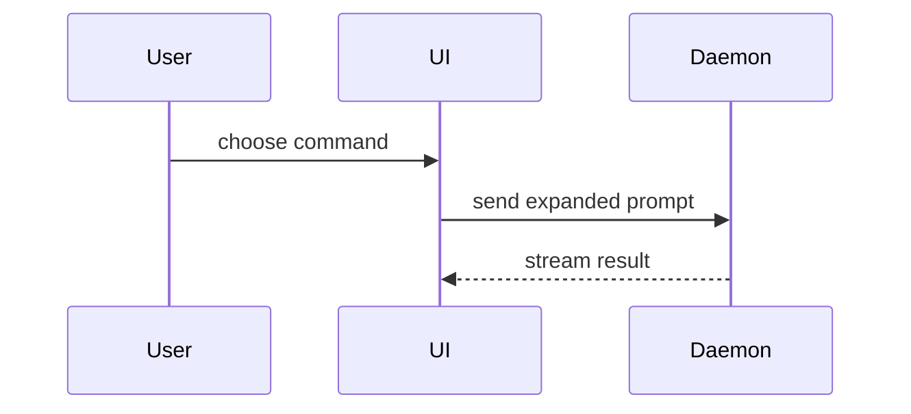

Read the [repository runtime contract](../poteto-mode/references/codex-tools.md) and root `AGENTS.md` before using this skill. Host instructions and the user's scope take precedence.

Help the user understand the current topic of conversation visually. Skip the preamble and keep prose brief. Pick the smallest view that makes the key point clear.

- Show logic or an algorithm as pseudocode:

```text
on(save)
  if content is unchanged
    return cached result
  write new content
  return fresh result
```

- Show runtime control flow as a call tree:

```text
submitForm
  createSession
    persistPrompt
    launchAgent
  navigateToSession
```

- Show UI structure as a component tree, including state and module boundaries that matter:

```tsx
<SessionPage> (apps/example/src/routes/session.tsx)
  useSessionEvents()
  <SessionToolbar>
    <RunSkillButton> (packages/ui)
```

- Show file responsibility or a broad refactor as a shallow file tree:

```text
src/
├── commands/       # parses user actions
├── sessions/       # owns session state
└── transport/      # sends API requests
```

- Show component interaction, control flow, or data flow with Mermaid:



- Use `diff` when the point is what changes and the surrounding shape already exists. Match the diff shape to the topic.

For a component change:

```diff
 <SessionPage>
   useSessionEvents()
   <SessionToolbar>
+    <RunSkillButton />
   <SessionTimeline>
+    <SkillResultCard />
```

For a file-layout change:

```diff
 src/
 ├── commands/
+│   └── show-me.ts       # expands the slash command
 ├── sessions/
-└── transport.ts
+└── transport/
+    ├── client.ts
+    └── stream.ts
```

For a call-tree or call-stack change:

```diff
 submitForm
   createSession
     persistPrompt
+    expandSkillMention
     launchAgent
-  navigateToSession
+  navigateToSession
+    subscribeToEvents
```

For a state or control-flow change:

```diff
 on(save)
-  write content
+  if content is unchanged
+    return cached result
+  write new content
+  invalidate cache
```

- Show the whole block when most of it is new, when omitted context would hide ownership or order, or when the user needs a copyable target shape:

```ts
function expandSkill(command: string): string {
  const skillName = command.slice(1)
  return `use the ${skillName} skill`
}
```

- For a visual UI, layout, state comparison, or concept too dense for Mermaid, write one focused HTML file — a diagram, an infographic, or a short slide deck, whichever fits the point. Match the product's colors, type, spacing, and components; use real labels and data; support desktop and mobile. Present it with the host's supported tools. In T3, use `html_preview` followed by `html_render`. Do not start a server or assume a shell `open` command will display it to the user. Keep artifacts self-contained when practical. Adding a renderer dependency requires checking its source, license, and the authorized scope.

Inspect the rendered result at desktop and narrow widths when tools permit. Keep the diagram source available and report missing rendering verification plainly.

### guidance

Place each visual next to the short text it supports. Keep only the calls, files, props, states, and boundaries needed to answer the user's current question or the options to resolve the current discussion point.

You may use one of these, you may use several, it is unlikely you will use all of them. Use your judgement and don't overwhelm the user.


## Bounded experiment mode

Use this mode when the user requests a prototype or experiment to settle a question that explanation cannot resolve. An ordinary explanation request does not authorize production code edits.

1. State the one question, the observable result that would answer it, and the time or scope limit if given.
2. Choose the smallest useful artifact: a state-model page with visible state and guided cases, a few structurally different UI alternatives, or a temporary runnable feasibility script. Do not force a technical experiment into HTML.
3. Work in a temporary directory or an authorized isolated worktree. Use synthetic fixtures or explicitly permitted data, with state kept in memory by default. Label simulated behavior. Real credentials, paid services, and live mutations require their own authorization.
4. Run the decisive scenario and inspect its result. For a visual artifact, inspect the rendered surface when tooling permits. Report a missing browser, device, or environment as an evidence limit rather than an observed result.
5. Return the question, outcome, evidence, and limitations. A prototype proves only the tested scenario; it does not establish production readiness or real integration performance.

Preserve the artifact as evidence by default. Do not automatically delete a branch, merge prototype code, create an ADR, or save learning records. Feed the observed result into an already-authorized `spec` or implementation task; otherwise end with the verdict. Production implementation still needs normal verification and scope controls.

When the user says "wait, you lost me", restore the missing premise in plain language before selecting a visual. Shorter wording alone may not resolve the misunderstanding.
