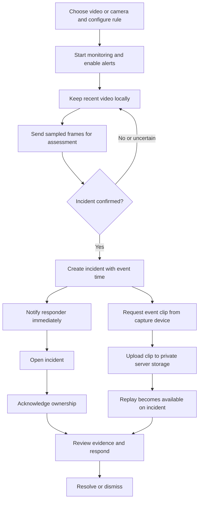
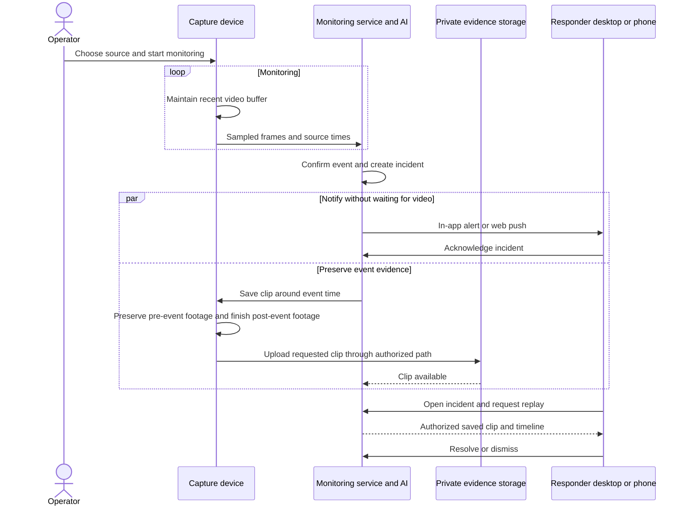
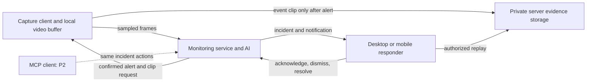

# Lookout experience and architecture

Updated direction from Ken's feedback. This design describes proposed behavior, not a shipped implementation. The [component spec](tech-spec.md) gives the main responsibilities; the [visual map](map.html) shows their interaction. The [PRD](../../PRD.md) owns product direction.

## The experience

Choose a local video or live camera on a capture device. Lookout keeps recent video locally while sending sampled observations for AI assessment. When an incident is confirmed, notify the responder and ask the capture device to save the relevant event clip to the server. The responder can replay that saved clip on desktop or mobile.

Full video is not continuously uploaded. Sampled images still leave the device for server-side AI assessment. This design does not move OpenAI inference into the browser.

The capture device and responder device can be different devices. A desktop can monitor the prerecorded crash or staged live fall while an Android phone or iPhone receives the alert. One device can perform both roles while the app is active.

## User flow

## Swimlane: detection, notification and replay

## Alert-triggered video saving

The alert identifies the event time in the capture session, rather than simply asking for footage from the moment the alert arrives. The local buffer must cover the event lead-in and assessment delay. The client preserves that segment while collecting a short amount of footage after the event.

For a local uploaded file, selection means loading it into the client for monitoring, not uploading the whole file to the server. The client extracts the requested interval from that file. Live sources depend on the rolling buffer. Clip length and local retention remain tuning choices.

Repeated observations update the same incident. Clip retries attach to that incident instead of creating new alerts. The incident displays `preparing`, `uploading`, `ready`, or `unavailable` evidence. If the source closes or the event has fallen out of the buffer, keep the alert and explain the missing replay. Do not claim the clip is saved until the server confirms it.

## Alert experience across devices

Recommend one responsive web app with PWA support.

| Situation | Experience |
| --- | --- |
| App open on desktop, Android or iOS | Prominent incoming-alert screen with incident summary, optional enabled sound, Open incident and Acknowledge actions. |
| App in background on a supported desktop or Android browser | Web push notification; tapping it opens the incident. Availability depends on permission, browser and OS settings. |
| iPhone or iPad in background | Web push through a Home Screen web app on supported iOS/iPadOS versions, with permission requested after a user action. |
| Push unavailable or denied | Show the limitation during setup. Keep in-app alerts and the incident inbox available while connected. |

The simulated call is Lookout's in-app alert presentation, not a telephone or VoIP call. Do not promise a full-screen system call UI, continuous ringtone, silent-mode bypass, or guaranteed lock-screen delivery from a website. A push opens the incident; it does not automatically acknowledge it. Closing the alert UI only silences that device, while Acknowledge changes incident ownership and stops subsequent escalation.

Offer an explicit Enable alerts step and a test sound. Sound remains subject to browser and OS behavior. Avoid labeling a hidden or suspended capture tab as active monitoring. Receiving push in the background does not keep camera recording or the video buffer running.

Native Android CallStyle and Apple's CallKit/PushKit are separate native calling capabilities. They are not required for this simulated-alert experience. Real phone integration is optional future work.

## Components and interaction

Keep the existing TanStack Start application. Cloudflare Workers host server behavior; a Durable Object can own incident state and escalation timing, and R2 can hold saved clips. These are recommended component choices, not a commitment to separate deployments or exact schemas.

## Demo outcomes

1. Replay a local crash video, detect the event, receive an alert, and replay the server-saved incident clip.
2. Stage a safe live fall, preserve footage around the event, and open the alert on another device.
3. Acknowledge on one device and observe the shared incident state change. No new escalation should be initiated afterward; already delivered OS notifications may remain.
4. Show that clip upload can finish after the initial alert, and that a failed upload is visible rather than silently reported as saved.

## Sources and evidence boundary

The scaffold was inspected at merged PR #4. This revision changes the previous real-phone and continuous-clip-upload assumptions. No device, push delivery, recording or replay test has run yet.

- [WebKit: iOS/iPadOS Home Screen web push](https://webkit.org/blog/13878/web-push-for-web-apps-on-ios-and-ipados/).
- [MDN: Push API](https://developer.mozilla.org/en-US/docs/Web/API/Push_API).
- [Chrome autoplay policy](https://developer.chrome.com/blog/autoplay/).
- [Apple VoIP notifications](https://developer.apple.com/documentation/pushkit/responding-to-voip-notifications-from-pushkit).
- [Android call-style notifications](https://developer.android.com/develop/ui/compose/notifications/call-style).

The Lookout team owns this design. Update it when the capture lifecycle, evidence-saving flow or alert experience changes.
