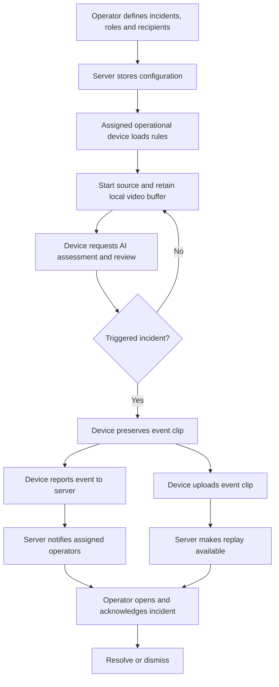

# Lookout experience and architecture

Proposed product design based on the [PRD](../../PRD.md). The [component spec](tech-spec.md) defines responsibilities; the [visual map](map.html) gives the overview. This revision separates two clients and selects device-owned decisions as the default. It does not implement them.

## Two clients

**Operator client.** The desktop/mobile workspace for defining incidents, assigning sources and rules, configuring roles and alert recipients, receiving incidents, replaying evidence, and acknowledging, dismissing or resolving incidents. It does not need to stay open for monitoring to continue.

**Operational-device client.** A dedicated monitoring interface for connecting CCTV, camera, local video or playback, starting the source, and showing device health. It runs continuously while active, keeps recent footage locally, executes the assessment loop and uploads triggered incident clips. It does not contain operator administration or incident-response controls.

These are separate client experiences and permission scopes. They may share code or deployment infrastructure; separate native applications are not required by this decision. A provisioned device can read its assigned rules and report events, but cannot change roles, choose arbitrary alert recipients or acknowledge incidents as an operator.

The main incident path is **operational device → server → operator**. Configuration travels back from the operator through the server to the assigned device.

## Decision location

**A is selected.** The operational device initiates Decisions API assessments, receives their results, manages candidate review, and decides when to report a triggered incident. It preserves the event clip locally, reports the event to the server, and uploads that clip. The server owns shared incident state, routing, replay and escalation.

The existing two-stage verification direction remains. The device initiates the first assessment and second-stage review before reporting a confirmed event; exact models remain open. The model inference runs at OpenAI, not locally on the device.

This is intended to reduce the upload-before-decision path and avoid storing non-triggered video in Lookout. Latency improvement is a hypothesis to measure, not an observed result. Sampled images still go to the model, and provider data handling is separate from Lookout's storage policy.

**B is deferred.** In the alternative considered, the operational device uploads video snippets and the server owns assessment. This is not the default and must not become an automatic fallback. Server-side assessment and permanent storage are separate choices; B would not inherently require retaining all footage forever.

### Credential boundary

A browser must not contain a long-lived OpenAI API key. For a web operational client, the recommended transport is an authenticated, stateless server relay: device requests assessment → relay calls OpenAI → result returns to device. The relay enforces device scope and usage limits but does not own the monitoring loop or persist non-triggered images, snippets or decision payloads in application storage or logs. This is a proposed credential-handling detail, not a switch to B.

A literal direct device-to-OpenAI connection requires a separately verified secure credential mechanism or managed device runtime. Do not assume browser-safe Decisions credentials exist. See [OpenAI authentication guidance](https://developers.openai.com/api/reference/overview#authentication).

## User flow



## Swimlane

```mermaid
sequenceDiagram
    participant O as Operator client
    participant S as Server
    participant D as Operational device
    participant AI as OpenAI via secure transport
    O->>S: Define incident rules, roles and recipients
    D->>S: Register device and load assigned rules
    S-->>D: Authorized configuration
    loop Device monitoring
        D->>D: Capture source and retain recent video
        D->>AI: Request sampled-frame decisions and candidate review
        AI-->>D: Assessment results
    end
    D->>D: Confirm trigger and preserve event interval
    D->>S: Report event with source, rule and event time
    S-->>D: Incident reference
    par Alert operator immediately
        S->>O: In-app alert or web push
        O->>S: Acknowledge incident
    and Save event evidence
        D->>S: Upload clip linked to incident
        S-->>O: Replay ready
    end
    O->>S: Request saved replay; resolve or dismiss
```

## Video and always-on behavior

A local video selection loads the file into the operational client; it does not upload the whole file. Live capture uses a rolling buffer. On trigger, preserve footage around the event time, including the lead-in and aftermath where available. Buffer duration must cover assessment delay. Untriggered video rolls out locally and is not stored by Lookout's server.

The device reports the incident before the clip is fully uploaded. Notification and saving proceed independently. Evidence states remain preparing, uploading, ready or unavailable. Retried reports and uploads attach to the same event. If a device disconnects before upload completes, show missing evidence rather than claiming replay exists.

Always-on is the operational device's intended job, not a guarantee that a mobile browser keeps running when locked or suspended. Show source and device health to operators. Paused, disconnected or stale devices must not appear healthy. CCTV connectivity and supported source protocols remain implementation choices; a browser cannot be assumed to open every camera stream.

The server distributes rule changes and revocations to devices. Reports identify the source session and rule version so the server can reject stale or unauthorized events. No model result may override configured recipients or roles.

## Operator notifications

Use a responsive web app/PWA. When open, show an incoming-alert screen with user-enabled sound. In the background, use supported web push to open the incident. iOS background web push requires a Home Screen web app and permission. Opening or silencing an alert does not acknowledge it; acknowledgment is an explicit shared-state action.

A simulated call is an in-app presentation. It does not promise a native phone-call screen, continuous background ringtone or silent-mode bypass. Real telephone calls remain optional. Acknowledgment stops new escalation; already delivered notifications may remain.

## Verification and ownership

Demonstrate both prerecorded crash and safely staged live fall using the operational client, then receive and replay the resulting incident in the operator client. Confirm the operator can close its UI without stopping the separate operational device. Exercise device disconnect, rule updates, denied permissions, duplicate reports, failed clip uploads and cross-device acknowledgment.

The Lookout team owns this design. Runtime behavior, latency, camera compatibility and device background limits remain unverified. Platform references: [WebKit push](https://webkit.org/blog/13878/web-push-for-web-apps-on-ios-and-ipados/), [Push API](https://developer.mozilla.org/en-US/docs/Web/API/Push_API), [Chrome sound policy](https://developer.chrome.com/blog/autoplay/), and [Decisions](https://developers.openai.com/api/docs/guides/decisions).
