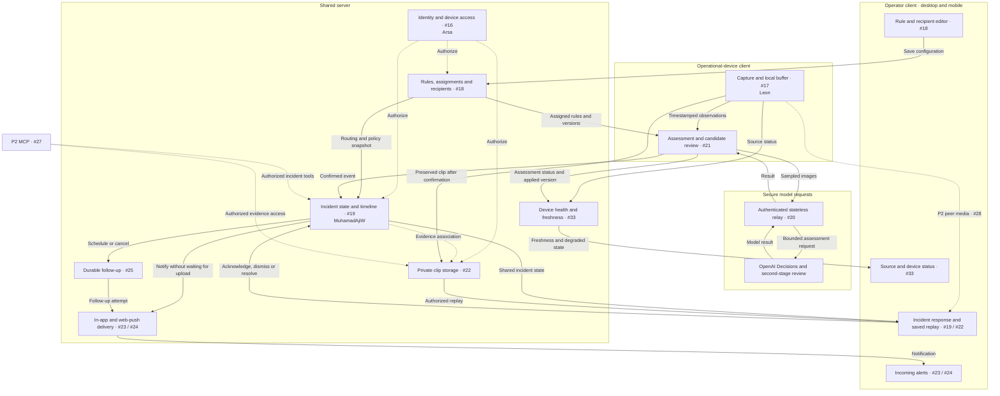
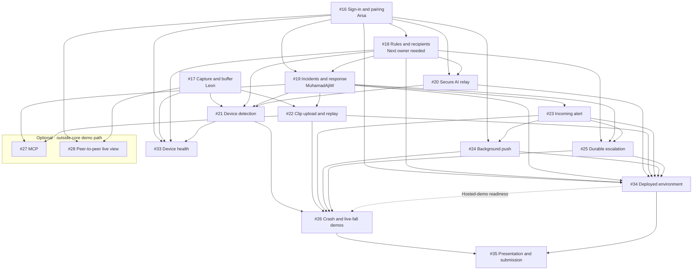

# Lookout service map and roadmap

This is the proposed architecture and work breakdown, not a record of implemented services. Ownership reflects the team's update and the GitHub issue snapshot checked on 7 November 2026. GitHub issues remain the source of truth for delivery status.

## Service map

Arrows show runtime interactions. The operational device owns the decision loop; OpenAI performs model inference remotely.

- Non-triggered video stays out of Lookout's persistent server storage. Sampled images still travel to the model through the relay.
- The device preserves the event interval, reports the incident, and uploads its clip. Notification does not wait for upload completion.
- Acknowledgment stops new escalation attempts, not clip preservation.
- Peer viewing uses authorized server signaling. It does not replace saved incident replay.
- The operator client can close while a separate active operational device continues monitoring. Browser suspension remains a device limitation.

## Issue dependency map

An arrow means the prerequisite must provide its output before the downstream issue can finish integration. It does not prohibit earlier contract work, UI fixtures or environment preparation.

The dashed deployment edge is the roadmap's readiness gate for a hosted demo; it has not been added to #26's issue body. Deployment preparation must not wait for #26, which would create a cycle. #33 is parallel monitoring work, not currently an explicit blocker in #26.

## What can start now

| Work                                                                           | Owner or next action                                                             | Integration prerequisite                         |
| ------------------------------------------------------------------------------ | -------------------------------------------------------------------------------- | ------------------------------------------------ |
| [#16 Sign-in and pairing](https://github.com/KenEzekiel/lookout-ai/issues/16)  | Arsa has picked it up.                                                           | None.                                            |
| [#17 Capture and buffer](https://github.com/KenEzekiel/lookout-ai/issues/17)   | Leon has picked it up.                                                           | None.                                            |
| [#18 Rules and recipients](https://github.com/KenEzekiel/lookout-ai/issues/18) | Pick an owner next. Agree identity and rule contracts with Arsa.                 | #16.                                             |
| [#19 Incident handling](https://github.com/KenEzekiel/lookout-ai/issues/19)    | Assigned to MuhamadAjiW. Start with synthetic reports and agreed contracts.      | #16 and #18.                                     |
| [#20 Secure AI relay](https://github.com/KenEzekiel/lookout-ai/issues/20)      | Define the request/result boundary and verify provider access.                   | #16 and #18.                                     |
| [#21 Device detection](https://github.com/KenEzekiel/lookout-ai/issues/21)     | Agree capture, rules, model results and event-report contracts.                  | #17, #18, #19 and #20.                           |
| [#22 Clips and replay](https://github.com/KenEzekiel/lookout-ai/issues/22)     | Prepare the replay UI and synthetic-event flow with Leon and the incident owner. | #17 and #19. Live AI integration also needs #21. |
| [#23 Incoming alert](https://github.com/KenEzekiel/lookout-ai/issues/23)       | Build the presentation against incident fixtures.                                | #19.                                             |
| [#24 Background push](https://github.com/KenEzekiel/lookout-ai/issues/24)      | Prepare permission and subscription UX; check target platforms.                  | #16 and #23.                                     |
| [#25 Escalation](https://github.com/KenEzekiel/lookout-ai/issues/25)           | Agree policy, cancellation and delivery contracts.                               | #18, #19 and #23.                                |
| [#33 Device health](https://github.com/KenEzekiel/lookout-ai/issues/33)        | Agree the health payload and prepare status UI.                                  | #16, #17, #18 and #21.                           |
| [#34 Environment](https://github.com/KenEzekiel/lookout-ai/issues/34)          | Inventory bindings, migrations and authorized deployment access.                 | Feature outputs listed in the dependency map.    |
| [#35 Submission](https://github.com/KenEzekiel/lookout-ai/issues/35)           | Draft the story, presentation and reuse declarations.                            | #26 and #34 for final evidence.                  |

[#26 Integrated demos](https://github.com/KenEzekiel/lookout-ai/issues/26) owns final end-to-end proof. [#27 MCP](https://github.com/KenEzekiel/lookout-ai/issues/27) and [#28 peer viewing](https://github.com/KenEzekiel/lookout-ai/issues/28) remain P2 even when their prerequisites become available.

## Wayfinder: decisions and handoffs

| Question                                                        | Depends on                                                               | Method                                               | State                                      | Resolution or next evidence                                                                                                        |
| --------------------------------------------------------------- | ------------------------------------------------------------------------ | ---------------------------------------------------- | ------------------------------------------ | ---------------------------------------------------------------------------------------------------------------------------------- |
| Where does the decision loop live?                              | Agreed product direction.                                                | Existing decision.                                   | Resolved.                                  | Operational device; remote inference through a secure relay. Server-owned monitoring is deferred.                                  |
| What identity and persistence contract do other components use? | Arsa's #16 implementation.                                               | Source review and owner handoff.                     | Open handoff.                              | Publish operator/device identity, assignment boundary, database engine and migration conventions. Do not create competing schemas. |
| How do assessment and clips consume the same source?            | Leon's #17 capture contract.                                             | Owner handoff and browser verification.              | Open handoff.                              | Publish source timestamps, capture epoch, buffer access and lifecycle events. Verify playable clip extraction in #22.              |
| What rule/version/recipient shape is authoritative?             | #16 identity and an owner for #18.                                       | Owner decision within agreed behavior.               | Open handoff.                              | Publish one versioned rule format used by configuration, relay and incident reporting.                                             |
| Which model access and second-stage review work for the demo?   | Approved provider access and existing experiment evidence.               | Source research and authorized runtime verification. | Open verification.                         | #20/#21 owners verify access and typed outcomes. Fall evidence does not establish crash detection quality.                         |
| Which deployed services and environment will the demo use?      | Feature-owned persistence/storage choices and authorized account access. | Configuration review and access prerequisite.        | Open.                                      | #34 coordinates bindings, secret names and migrations, then verifies the deployed revision after authorized deployment.            |
| Do target devices receive background alerts and replay clips?   | #22 and #24 integrations and target devices.                             | Real-device verification.                            | Blocked on implementation/device evidence. | Record actual browser/platform behavior and limitations. Do not infer delivery from CI.                                            |
| Does the final demo prove the claimed behavior?                 | #21–#25 and hosted environment readiness when applicable.                | End-to-end demo.                                     | Blocked on integration.                    | #26 records observed results; #35 uses those results for final claims.                                                             |

Do not reopen the two-client split, trigger-only storage, human incident response, or P2 priority of MCP and live viewing. Broader operator role administration, network CCTV protocols and third-party messaging are outside this roadmap's current implementation scope.

## Verification boundary

The dependency graph has no cycles. Issue ownership and open status were checked when preparing the HTML roadmap; this Markdown is a snapshot, not a live tracker. The map does not establish that product behavior, deployment or provider access has been verified. Creating this artifact does not assign work, change issues, authorize provisioning or submit the project.
