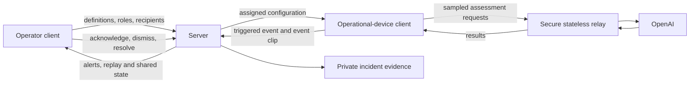

# Lookout component spec

High-level responsibilities for the [two-client design](design.md). These are proposed components, not implemented capabilities. Keep endpoint, schema and codec details with implementation work.

## Main components

| Component                        | Responsibility                                                                                                    | Interactions                                                                                                                 |
| -------------------------------- | ----------------------------------------------------------------------------------------------------------------- | ---------------------------------------------------------------------------------------------------------------------------- |
| Operator client                  | Define incidents and rules, configure roles and recipients, receive alerts, replay and handle incidents.          | Reads and changes authorized configuration and incident state through the server.                                            |
| Operational-device client        | Connect CCTV/video/playback, start continuous monitoring, retain a local buffer and show health.                  | Loads assigned rules, requests AI decisions, reports triggered events and uploads their clips.                               |
| Device assessment loop, option A | Initiate Decisions and second-stage review, interpret results and preserve the event interval.                    | Runs under the operational client; receives remote model results before reporting a trigger.                                 |
| Secure AI transport              | Protect model credentials and enforce device scope and usage limits.                                              | Recommended stateless relay for browser clients; forwards bounded assessment requests without retaining non-triggered media. |
| Server configuration and access  | Store incident definitions, source assignments, roles and recipients; authorize operators and devices separately. | Distributes configuration to devices and validates reports against their assignments.                                        |
| Server incident management       | Own incident identity, deduplication, timeline, acknowledgment and escalation.                                    | Accepts triggered reports and routes alerts to configured operators.                                                         |
| Private clip storage and replay  | Store event clips after triggers and expose authorized replay.                                                    | Associates uploads with incidents and reports preparing/uploading/ready/unavailable evidence.                                |
| Notification delivery            | Deliver in-app alerts and supported web push.                                                                     | Reaches operator clients independently of clip-upload completion.                                                            |
| MCP, P2                          | Inspect and acknowledge incidents as an authorized agent.                                                         | Uses the same server incident actions as the operator client.                                                                |

## Interactions

A is the selected decision owner. B, uploading snippets for a server-owned assessment loop, remains deferred. The relay is credential transport, not an incident decision engine. No background server monitor should be added as an implicit fallback.

## Shared behavior

- The operational device owns sampling, buffering and the decision loop. OpenAI performs inference remotely.
- The server owns configuration permissions, incident state, alert routing and escalation. It validates device scope and rule versions before accepting an event.
- Non-triggered footage stays out of Lookout's persistent server storage. Model requests still transmit selected images; do not equate this with offline inference or a provider zero-retention guarantee.
- Preserve the event interval locally as soon as it triggers. Report the event first, then upload its clip without delaying the operator notification.
- Repeated reports and upload retries enrich the same incident. Failed uploads remain visible.
- The operator can acknowledge independently of evidence readiness. Acknowledgment stops further escalation, not clip preservation.
- Keep device permissions limited to assigned configuration, device health and event/evidence submission. Operator role and recipient changes use the operator client.
- Maintain visible source health and configuration freshness. Always-on operation requires an active capable device; browser suspension and unsupported CCTV protocols must be surfaced.

## Work areas

| Area                       | Deliverable                                                                                                |
| -------------------------- | ---------------------------------------------------------------------------------------------------------- |
| Operator experience        | Incident-definition editor, roles/recipients, alert inbox, replay and response controls.                   |
| Operational device         | Dedicated source setup, start/stop and health view, local buffer and device-owned assessment loop.         |
| Shared server              | Configuration distribution, operator/device permissions, incident reporting, deduplication and escalation. |
| Evidence and notifications | Trigger-only clip saving, private replay, in-app and web-push alerts.                                      |
| Integration                | Both demo sources feeding a separate operator device, including failures and reconnects.                   |

Retain the existing React/TanStack Start app foundation. Separate client routes or entrypoints may share code. Cloudflare remains preferred for server components and private evidence storage; exact deployment separation is open.

## What to verify

Both demos must follow operational device → server → operator. Verify no server-retained footage for non-triggered periods, and no model API key in browser code. Confirm a trigger produces one incident, its clip replays on the operator device, and alerting does not wait for upload. Check rule updates, revoked device access, stale reports, duplicate uploads, operator permissions and cross-device acknowledgment. Measure latency before claiming A is faster.

The access implementation and its verification boundary are described below. Monitoring and delivery remain planned. The Lookout team maintains these boundaries as the components evolve.

## Implemented access boundary

The access slice uses Better Auth for email/password accounts and human sessions, Drizzle schema definitions, and Cloudflare D1 with committed SQL migrations. Application-owned workspace, membership, invitation, device, and pairing tables enforce the demo policy in the PRD. The Better Auth organization plugin is not enabled because its email-bound invitations differ from the accepted bearer links and codes.

`apps/app/src/lib/access.ts` defines the principal union. `server/access.ts` resolves visitors, unassigned people, workspace members, and monitoring devices. Each protected handler rechecks the current session, membership, or device revocation record. Later operator handlers use `member`; owner-only operations use its owner check. Monitoring handlers use `monitoringDevice` and derive the workspace from that identity. Resource queries must include that workspace ID. The demo grants devices all sources in that workspace, replacing the earlier per-source assignment requirement for this slice.

`server/workspaces.ts` owns create/join, invitation redemption, and removal. D1 batches and constraints make workspace creation and single-use invitation redemption atomic. `server/devices.ts` owns pairing and revocation. A pairing browser holds a private HttpOnly claim cookie in addition to the visible code. Owner approval does not disclose its credential. Only the original browser can claim it. The device cookie has a rolling browser-supported lifetime; clearing browser storage or leaving it unused beyond that lifetime requires re-pairing. The database identity remains until revoked.

Route adapters load server modules within server handlers. Shared components call same-origin HTTP endpoints. Mutation handlers validate Origin. Credentials stay in HttpOnly cookies, device token hashes stay in D1, and short-code endpoints enforce database-backed attempt limits. No additional auth service or generalized permission framework is introduced.

The current UI confirms device authorization only. Source capture, AI decisions, incident responses, and source configuration remain later slices. The access tests prove that devices cannot call the existing human administration handlers. Each new incident or monitoring handler must add its own integration coverage at the same boundary.
